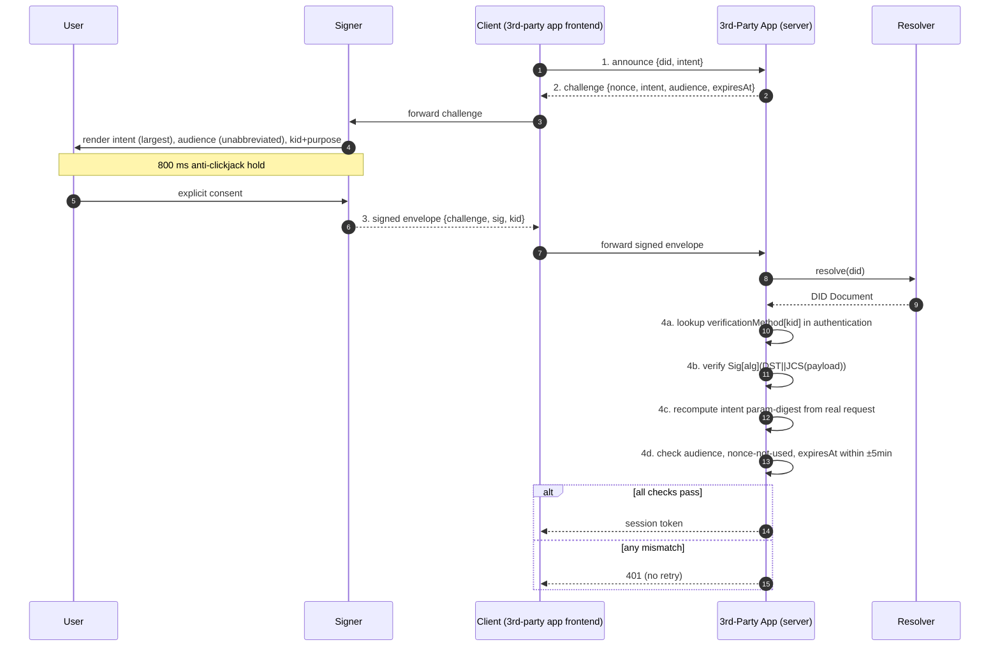
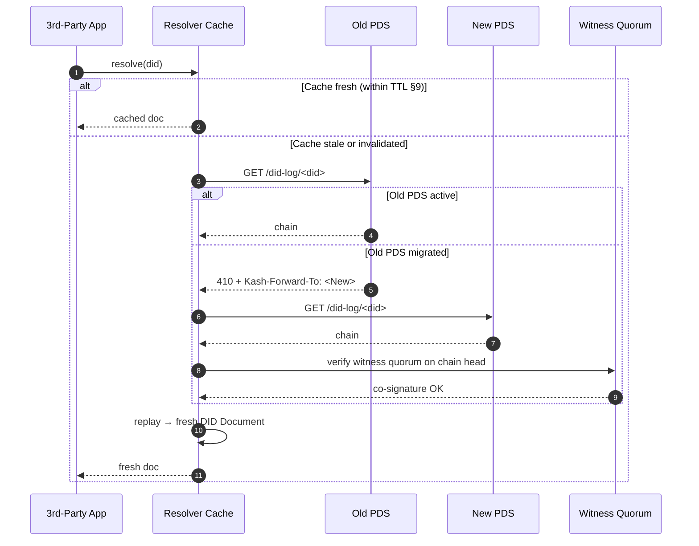
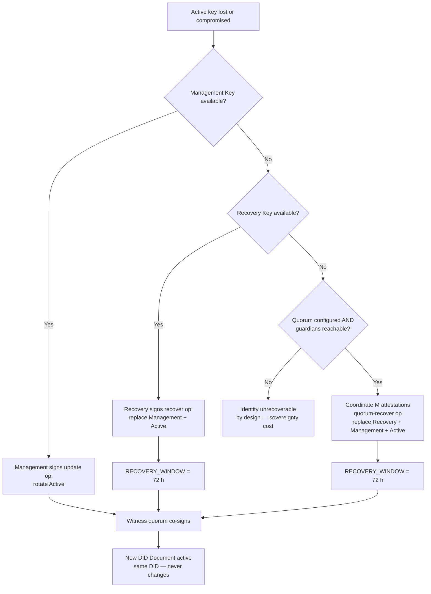

# Kash Identity Bible — v1.1
**`specs/identity-protocol-v1.md` — Phase 1 Final · Source-of-Truth for Phase 3 Implementation**

> The Kash Identity Foundry exposes a sovereign, headless decentralized-identifier method (`did:kash`). This document is the protocol contract: any Phase-3 code MUST cite section numbers from this file. Deviations require an amendment commit before merge.
>
> **Inspirations:** Nostr (key-as-identity simplicity) · AT Protocol (`did:plc` op log + PDS) · Web5 (DID + DWN separation) · W3C DID Core 1.0 · GDPR Art 5 / 17 / 20 (data sovereignty).
>
> **Two load-bearing properties:**
> 1. **Headless.** No KashScript runtime is required for any protocol step. See §12.
> 2. **GDPR-aligned by construction.** Personal data lives in user-owned PDS, never in the op log. See §13.

> **Implementation status (2026-07-04).** The shipped `@kashscript/identity-core`
> (≥ 0.3.x) implements the **self-certifying subset** of `did:kash` —
> `did:kash:<base58btc(Ed25519 pubkey)>`, with the DID Document reconstructed locally
> via `createDidDocument()`. The full op-log / witness machinery specified in §2–§4 is
> **target architecture** and is not yet shipped: today, key rotation and social
> recovery ship as signed peer-to-peer artifacts (succession chains + M-of-N guardian
> quorum in `@kashscript/identity-sdk`) rather than op-log replay, and no resolver is
> operated (`services/kash-resolver` records its build triggers). The shipped-vs-target
> boundary and its rationale are recorded in
> [`docs/adr/0003-self-certifying-did-kash.md`](../docs/adr/0003-self-certifying-did-kash.md).

> **Agent-identity profile (2026-07-05, M2).** The **server-side** identity surface (server-issued
> guest DIDs, the §7 handshake, DID resolution, the PDS write contract) and the **agent-identity /
> MCP-OAuth** token profile — a `did:kash` root minting OAuth 2.1 + PKCE, RFC 8707 audience-bound,
> RFC 8693 agent→owner-delegated access tokens — ship in `@kashscript/identity-server`. That is the
> auth surface `@kashscript/hudhud` (M5) consumes. Full contract:
> [`identity-server.md`](identity-server.md). The `did:kash` method itself remains as specified here.

---

## 0. Goals & Non-Goals

### 0.1 Goals
- Sovereign, **headless** identity — no central runtime dependency on KashScript.
- **Stable DIDs across key rotation.** A leaked daily-signing key never burns the identifier.
- **Four-tier key hierarchy** (Active → Management → Recovery → Quorum) with one-way privilege.
- **Race-free key management** via monotonic sequence numbers + recovery-tier guard windows.
- **Logic-only social recovery** for total-loss scenarios. No custodial escape hatch.
- **Algorithmic agility.** Ed25519 today; reserved slots for Passkeys (Phase 4) and zk-friendly curves (Phase 5).
- **Lexicon-ready PDS** so Phase-2 record schemas plug in without protocol changes.
- **GDPR-aligned data sovereignty** (§13).

### 0.2 Non-Goals
- Global handle namespace (handles are advisory; see §8.4).
- Consensus or token economics (anchored attestations live in `@kashscript/trade`).
- Centralized recovery custodian. The protocol composes with itself.

### 0.3 Headlessness Statement
At every protocol step — create, resolve, rotate, recover, handshake, migrate — the parties involved are: the **user's Signer**, **third-party apps**, **user-chosen Witnesses**, and the **user's PDS**. KashScript operates none of these as a runtime requirement. See §12 for component-by-component verification.

---

## 1. Glossary (Standardized Terminology)

| Term            | Definition                                                                 |
|-----------------|----------------------------------------------------------------------------|
| **DID**         | Decentralized Identifier (W3C DID Core 1.0).                               |
| **did:kash**      | The Kash DID method — hash-of-genesis-op identifier.                       |
| **DID Document**| The JSON-LD object describing current keys, services, and metadata.        |
| **Op**          | A single signed operation (`create`, `update`, `recover`, `set-recovery-quorum`, `quorum-recover`, `deactivate`). |
| **Op Log**      | The ordered chain of Ops that, replayed, produces the current DID Document. |
| **`seq`**       | Monotonic integer (uint64) attached to every op, starting at 0 for genesis. |
| **`prev`**      | SHA-256 hash of the prior op's canonical bytes (null for genesis).         |
| **Signer**      | The user-controlled agent that holds private keys (browser ext, mobile app, hardware). |
| **PDS**         | Personal Data Store — the user-chosen host for records and op-log mirror. Aliased as **DWN** (Decentralized Web Node) in Web5; Kash uses PDS canonically. |
| **Lexicon**     | Schema for a PDS record collection, identified by NSID. Phase-2 concept.   |
| **Witness**     | An independent log operator that co-signs Ops and gossips chain heads.     |
| **Verifier**    | Any third-party validating a handshake signature against a DID Document.   |
| **Quorum**      | An M-of-N set of guardian DIDs designated for social recovery.             |
| **NSID**        | Namespaced identifier in reverse-domain form (e.g., `app.duedale.listing`). |
| **DST**         | Domain-Separation Tag — string prefix bound into every signature (§5.5).   |

RFC 2119 keywords (**MUST / SHOULD / MAY**) apply throughout.

---

## 2. The `did:kash` Method

### 2.1 URI Structure

```
did:kash:<method-specific-identifier>
```

- `kash` is the registered method ID — collision-free with `did:key`, `did:plc`, `did:web`, `did:ion`.
- `method-specific-identifier` (MSI) is **exactly 32 base32 characters** (RFC 4648, lowercase, no padding) decoding to **20 bytes / 160 bits**.

```
did:kash:5g7q2hvh3xkvjnq7tzaaymzfeswftxnnyya
```

### 2.2 Why Hash-of-Genesis (and not Hash-of-Pubkey)

A pubkey-as-DID (`did:key`-style) ties identity to a single signing key forever. Rotation is impossible without burning the identifier. A hash-of-genesis-op DID makes the **DID immutable** while the **key state evolves** through a signed op chain.

### 2.3 The Genesis Operation

Every `did:kash` is born from a Genesis Op signed by the initial Recovery Key:

```jsonc
{
  "op":         "create",
  "version":    1,
  "seq":        0,
  "createdAt":  "2026-05-09T12:00:00Z",
  "rotationKeys": [
    { "id": "#rec-1",  "alg": "ed25519", "key": "z6MkiR…", "purpose": "recovery"   },
    { "id": "#mgmt-1", "alg": "ed25519", "key": "z6MkiM…", "purpose": "management" }
  ],
  "verificationKeys": [
    { "id": "#sig-1",  "alg": "ed25519", "key": "z6MkiA…", "purpose": "active"     }
  ],
  "alsoKnownAs": ["at://kashif.kashscript.com"],
  "service": [
    { "id": "#pds",          "type": "PersonalDataStore", "endpoint": "https://pds.example.com" },
    { "id": "#pds-mirror-1", "type": "PersonalDataStore", "endpoint": "https://pds.backup.example.org" }
  ],
  "witnesses": [
    "did:kash:wit-aaa…",
    "did:kash:wit-bbb…",
    "did:kash:wit-ccc…"
  ],
  "prev":      null,
  "sig":       "z…recoveryKeySig"
}
```

The DID is computed before publication:

```
did:kash:<base32-truncate-20( SHA-256( JCS(genesis-op without "sig") ) )>
```

The `sig` field is excluded from the hash because the signature depends on the canonical bytes. Once computed, the DID is immutable for the lifetime of the identity.

### 2.4 Cryptographic Primitives (Normative)

- **Hash:** SHA-256 (FIPS 180-4).
- **Canonical JSON:** RFC 8785 (JCS).
- **Default signature:** Ed25519 (RFC 8032). Deterministic; no nonce-reuse risk.
- **Passkey signature (Phase 4):** ES256 / P-256 (FIDO2 baseline).
- **zk-friendly (Phase 5):** BLS12-381 G2 keys / G1 sigs.
- **Multibase:** `z` prefix (base58-btc).
- **Multikey codec:** W3C Multikey registry (Ed25519=`0xed01`, secp256k1=`0xe701`, BLS12-381-G2=`0xeb01`, P-256=`0x1200`).

### 2.5 Resolution (Headless)

Resolution is deterministic replay of the op log. Any party with the chain can reproduce the current DID Document.

```mermaid
sequenceDiagram
    autonumber
    participant V as Verifier
    participant H as Hint (alsoKnownAs / DNS)
    participant W as Witness Quorum (≥3)
    participant P as PDS (op-log mirror)
    Note over V: holds did:kash:5g7q…
    V->>H: lookup hint (handle → PDS URL)
    alt Hint resolves & PDS reachable
        V->>P: GET /did-log/did:kash:5g7q…
        P-->>V: ordered op chain
    else Hint stale or PDS migrated (HTTP 410)
        P-->>V: 410 + Kash-Forward-To: <new-endpoint>
        V->>P: re-fetch from new endpoint
    else Both unreachable
        V->>W: query witness quorum for chain head
        W-->>V: chain + witness co-signatures
    end
    V->>V: verify genesis hash == DID
    V->>V: replay ops; validate sig + seq monotonicity per op
    V->>V: verify witness quorum co-signatures (§7)
    V->>V: emit current DID Document
```

**Authority order on conflict:** op-chain bytes (canonical) > witness quorum (tamper-evidence) > PDS hosting (convenience, distrusted by default).

---

## 3. The DID Document

### 3.1 JSON-LD Shape

```jsonc
{
  "@context": [
    "https://www.w3.org/ns/did/v1",
    "https://kashscript.com/ns/did/v1"
  ],
  "id": "did:kash:5g7q2hvh3xkvjnq7tzaaymzfeswftxnnyya",
  "alsoKnownAs": ["at://kashif.kashscript.com"],

  "verificationMethod": [
    { "id": "did:kash:5g7q…#sig-1",  "type": "Multikey", "controller": "did:kash:5g7q…", "publicKeyMultibase": "z6MkiA…", "algorithm": "ed25519", "purpose": "active"     },
    { "id": "did:kash:5g7q…#mgmt-1", "type": "Multikey", "controller": "did:kash:5g7q…", "publicKeyMultibase": "z6MkiM…", "algorithm": "ed25519", "purpose": "management" },
    { "id": "did:kash:5g7q…#rec-1",  "type": "Multikey", "controller": "did:kash:5g7q…", "publicKeyMultibase": "z6MkiR…", "algorithm": "ed25519", "purpose": "recovery"   }
  ],

  "authentication":       ["did:kash:5g7q…#sig-1"],
  "assertionMethod":      ["did:kash:5g7q…#sig-1"],
  "capabilityInvocation": ["did:kash:5g7q…#mgmt-1"],

  "quorum": {
    "id":        "did:kash:5g7q…#quorum",
    "threshold": 3,
    "guardians": ["did:kash:abc…", "did:kash:def…", "did:kash:ghi…", "did:kash:jkl…", "did:kash:mno…"]
  },

  "service": [
    { "id": "did:kash:5g7q…#pds",           "type": "PersonalDataStore", "serviceEndpoint": "https://pds.example.com" },
    { "id": "did:kash:5g7q…#pds-mirror-1",  "type": "PersonalDataStore", "serviceEndpoint": "https://pds.backup.example.org" },
    { "id": "did:kash:5g7q…#trade",         "type": "TradeAttestor",     "serviceEndpoint": "https://attestor.duedale.app" },
    { "id": "did:kash:5g7q…#neuron",        "type": "NeuronGateway",     "serviceEndpoint": "https://gateway.oreoasis.app" }
  ],

  "witnesses": ["did:kash:wit-aaa…", "did:kash:wit-bbb…", "did:kash:wit-ccc…"],

  "head":      { "seq": 7, "opCid": "z3hashOfHeadOp" },
  "createdAt": "2026-05-09T12:00:00Z",
  "updatedAt": "2026-08-11T09:42:11Z"
}
```

### 3.2 Verification Methods — `purpose` Slot

The `purpose` field is a Kash extension to W3C Multikey:

| `purpose`     | Used for                                          | Storage location          |
|---------------|---------------------------------------------------|---------------------------|
| `active`      | Daily signing (handshake, posts, attestations)    | Hot device                |
| `management`  | Authoring rotation/update Ops                     | Warm device               |
| `recovery`    | Authoring recovery Ops; emergency authority       | Cold (paper / HSM)        |
| `assertion`   | Issuing verifiable credentials                    | Hot device                |
| `delegation`  | Issuing capability tokens (object-cap)            | Hot device                |

Resolvers SHALL reject documents where a verification method's `purpose` is inconsistent with its W3C-relationship-array placement (e.g., an `active` key listed in `capabilityInvocation`).

### 3.3 Service Endpoints — Multi-PDS Support

| `type`                | Owner package         | Holds                                          |
|-----------------------|-----------------------|------------------------------------------------|
| `PersonalDataStore`   | `@kashscript/identity-core`| Records, social graph, op-log mirror, lexicons |
| `TradeAttestor`       | `@kashscript/trade`   | Reputation receipts, dispute history           |
| `NeuronGateway`       | `@kashscript/neuron`  | Consent-bound RAG/agent endpoints              |

**Multiple PDS endpoints are explicitly supported.** A user MAY declare `#pds` (primary) and one or more `#pds-mirror-N` mirrors. Resolvers MUST try the primary first; on `5xx` or `410 Gone`, they MUST fall through the mirror list in declaration order before consulting the witness quorum. This makes provider failure transparent without protocol intervention.

Additional service types are permitted; resolvers SHOULD pass them through opaquely.

### 3.4 Document Invariants

A resolver SHALL reject any document failing **any** of:

1. `id` equals the SHA-256 hash of the genesis op (truncated as in §2.1).
2. `head.seq` equals the highest valid `seq` in the op chain.
3. `head.opCid` equals `SHA-256(JCS(latest-op))`.
4. `updatedAt` equals the `createdAt` of the chain's most recent op.
5. At least one verification method per `purpose ∈ {active, management, recovery}`.
6. `witnesses` lists at least 3 distinct DIDs.
7. If `quorum` is present, `1 ≤ threshold ≤ guardians.length`.

---

## 4. Key Management Lifecycle

### 4.1 Four-Tier Hierarchy

```
            ┌────────────────────────────────────────┐
            │  QUORUM (M-of-N guardian DIDs)         │   social recovery — §4.4
            └────────────────┬───────────────────────┘
                             │ can replace
            ┌────────────────▼───────────────────────┐
            │  RECOVERY KEY (cold, paper / HSM)      │   §4.3
            └────────────────┬───────────────────────┘
                             │ can replace
            ┌────────────────▼───────────────────────┐
            │  MANAGEMENT KEY (warm device)          │   rotation authority — §4.2
            └────────────────┬───────────────────────┘
                             │ can rotate
            ┌────────────────▼───────────────────────┐
            │  ACTIVE KEY(S) (hot device)            │   daily signing — §5
            └────────────────────────────────────────┘
```

Privilege flows downward only. Enforced at op-validation time per §3.4 and §4.5.

### 4.2 Rotation (Active or Management Keys)

A Management-tier `update` op patches the verification-key set:

```jsonc
{
  "op":        "update",
  "version":   1,
  "seq":       3,
  "createdAt": "2026-08-01T10:00:00Z",
  "prev":      "z3hashOfPriorOp",
  "patches": [
    { "op": "remove",  "path": "/verificationKeys/sig-1" },
    { "op": "add",     "path": "/verificationKeys/-",     "value": { "id": "#sig-2", "alg": "ed25519", "key": "z6MkiB…", "purpose": "active" } },
    { "op": "replace", "path": "/authentication",         "value": ["#sig-2"] }
  ],
  "sig":       "z…signedByCurrentManagementKey"
}
```

**Resolver MUST enforce on every op:**

1. **Sequence monotonicity:** `op.seq === prevOp.seq + 1` (no gaps, no rewinds).
2. **Linkage:** `op.prev` matches `SHA-256(JCS(prevOp))`.
3. **Tier authority:** `sig` verifies under a key whose `purpose` covers the requested change:
   - Patches touching `purpose: management` keys → require Recovery-Key signature **or** Quorum signature.
   - Patches touching `purpose: recovery` keys → require Recovery-Key signature **or** Quorum signature, **and** are subject to §4.5.
   - All other patches → accept Management-Key signature.
4. **Time sanity:** `createdAt` is monotonically non-decreasing relative to `prev`.
5. **Invariant preservation:** the post-patch document satisfies §3.4.

The combination of `seq` (integer ordering) and `prev` (cryptographic linkage) closes any race where an attacker tries to insert an out-of-order op or reuse a stale `prev`. Both must agree, and both are verified before the op is admitted.

### 4.3 Recovery (Recovery Key)

If the Management Key is lost or compromised, the Recovery Key publishes a `recover` op replacing it wholesale. Recovery ops are subject to §4.5.

### 4.4 Quorum Recovery — Social Recovery

To survive total loss (every key destroyed), the user pre-publishes a `set-recovery-quorum` op (signed by the Recovery Key) designating **N guardian DIDs** and a threshold **M ≤ N**:

```jsonc
{
  "op":        "set-recovery-quorum",
  "version":   1,
  "seq":       2,
  "createdAt": "2026-05-09T12:00:00Z",
  "prev":      "z3hash…",
  "threshold": 3,
  "guardians": ["did:kash:abc…", "did:kash:def…", "did:kash:ghi…", "did:kash:jkl…", "did:kash:mno…"],
  "sig":       "z…recoveryKeySig"
}
```

Once published, M of N guardians can co-sign a `quorum-recover` op replacing the Active, Management, and Recovery key sets wholesale:

```jsonc
{
  "op":        "quorum-recover",
  "version":   1,
  "seq":       11,
  "createdAt": "2026-09-12T08:00:00Z",
  "prev":      "z3hashOfPriorOp",
  "newRotationKeys":     [ { "id":"#rec-2",  "alg":"ed25519", "key":"z6Mki…R2", "purpose":"recovery"   },
                           { "id":"#mgmt-2", "alg":"ed25519", "key":"z6Mki…M2", "purpose":"management" } ],
  "newVerificationKeys": [ { "id":"#sig-2",  "alg":"ed25519", "key":"z6Mki…A2", "purpose":"active"     } ],
  "attestations": [
    { "guardian": "did:kash:abc…", "sig": "z…sig1" },
    { "guardian": "did:kash:def…", "sig": "z…sig2" },
    { "guardian": "did:kash:ghi…", "sig": "z…sig3" }
  ]
}
```

**Validation:**

1. Each `attestation.sig` MUST verify under the *current* `purpose: active` key of the guardian DID, resolved fresh via `did:kash` (recursive composition — no foundry hosting).
2. The set of attesting guardians MUST be a subset of the most-recent **finalized** `set-recovery-quorum` op's `guardians` (i.e., one whose §4.5 guard window has elapsed). A non-final `set-recovery-quorum` MUST NOT be used to authorize a `quorum-recover`.
3. Valid attestation count MUST be ≥ `threshold`.
4. Each attestation MUST be produced over the exact signed-bytes specified in §4.4.1 below, with the `kash-quorum-attest-v1\n` DST (§5.5).
5. Quorum-recover ops are themselves subject to §4.5 (non-final for `RECOVERY_WINDOW`).

#### 4.4.1 Guardian Attestation — Signed-Bytes Specification

A guardian's `attestation.sig` is the Ed25519 signature over the following byte string:

```
sig_input =
  "kash-quorum-attest-v1\n"   ||  /* DST, UTF-8, single LF terminator */
  JCS({                            /* RFC 8785 canonical JSON of: */
    "v":         1,                            /* attestation envelope version */
    "target":    "<did:kash of subject>",        /* whose identity is recovered */
    "op": {                                    /* MINUS op.attestations[] */
      "op":                  "quorum-recover",
      "version":             <op.version>,
      "seq":                 <op.seq>,
      "prev":                "<op.prev>",
      "createdAt":           "<op.createdAt>",
      "newRotationKeys":     [ ... ],          /* verbatim from op */
      "newVerificationKeys": [ ... ]           /* verbatim from op */
    },
    "guardian":  "<did:kash of this guardian>",  /* binds to one guardian only */
    "expiresAt": "<ISO-8601 UTC>"              /* RECOMMENDED ≤ 30d; OPTIONAL */
  })
```

**Field bindings — why each is load-bearing:**

| Field        | Replay it prevents                                                                       |
|--------------|------------------------------------------------------------------------------------------|
| `target`     | Attestation aggregated against a different DID. Without it, a guardian's sig against identity *X* could be reused on a recovery op for identity *Y* where the same guardian appears.|
| `op.seq` / `op.prev` | Re-using a stale attestation on a *later* recovery attempt with different key sets (the new keys would not match what was attested). |
| `op.new*Keys` | Key-substitution: an attacker swapping the new key sets after gathering attestations.   |
| `guardian`   | Re-attribution: an attestation lifted from `did:kash:abc` being credited as if from `did:kash:def`. |
| `expiresAt`  | Indefinite stockpiling. RECOMMENDED so a leaked attestation has bounded shelf life.     |

**Verifier procedure:**

1. For each `attestation[i]` in the quorum-recover op:
   1. Resolve `attestation[i].guardian` to its current `purpose: active` key.
   2. Reconstruct `sig_input` from `target` (the recovering DID), the op's outer fields *excluding* `attestations`, this guardian's DID, and the guardian-supplied `expiresAt` (if present).
   3. Verify `attestation[i].sig` against `sig_input` under the resolved key.
   4. If `expiresAt` present, reject if `now > expiresAt`.
2. After all attestations pass, validate quorum membership (item 2) and threshold (item 3).

Attestations are **per-(target, op, guardian)**. A guardian who wishes to authorise a different recovery op MUST sign a fresh attestation.

> **Product guidance (non-normative):** users SHOULD pick guardians that are geographically and socially diverse; prefer thresholds **M ≥ 3**. Guardian collusion is the residual risk.

### 4.5 Recovery-Tier Guard — The Race-Condition Closer

> **Load-bearing rule that prevents stolen-device takeover.**

The following op categories are **non-final for `RECOVERY_WINDOW = 72 h`** — regardless of which tier signed them:

1. **Recovery-key mutation.** Any op whose patch set adds, removes, or replaces an entry of `purpose: "recovery"`.
2. **Quorum configuration.** Any `set-recovery-quorum` op (changes the guardian set or threshold).
3. **Quorum execution.** Any `quorum-recover` op (replaces Active / Management / Recovery sets wholesale).

Within the window:
- A Recovery-Key signature MAY publish a competing op that supersedes a `set-recovery-quorum` or a recovery-key mutation.
- A Quorum signature MAY publish a competing op that supersedes any of the three categories.

Resolvers MUST NOT treat such ops as canonical until the window closes. Tier precedence (§8.1) decides among competing ops; same-tier ties broken by lowest SHA-256 tip-hash. A subsequent `quorum-recover` MUST reject any attestation whose binding refers to a not-yet-final `set-recovery-quorum` (§4.4 validation rule 2).

**Why this works:**

- Against an Active+Management compromise: a thief cannot finalize the removal of a Recovery Key fast enough to outrun the legitimate user's cold Recovery Key.
- Against a Recovery-Key compromise (NEW, F3): a thief who has captured the Recovery Key can publish `set-recovery-quorum` with colluding guardians, but cannot escalate to `quorum-recover` for 72 h. The legitimate user — alerted by their resolver / witness feed — has the same 72 h to publish a competing `set-recovery-quorum` under the same Recovery Key (or higher) that restores the true guardian set. Total identity takeover therefore requires sustained Recovery-Key control for ≥ 72 h, not a momentary compromise.

Total identity takeover requires compromising the Recovery Key tier *and* outlasting the guard window — paper / HSM by design.

#### 4.5.1 Resolver Behaviour During the Guard Window  *(F8)*

When a resolver sees a §4.5 op that has not yet finalized:

1. **Returned document.** Resolvers MUST continue to return the **pre-op** DID Document for any non-handshake query (cosmetic reads, lexicon resolution, PDS endpoint lookup). Returning the post-op document early would allow a thief's not-yet-final key change to be honoured by trusting verifiers.
2. **Pending metadata.** Resolvers MUST expose a `pendingOps: PendingOp[]` field alongside the returned document containing the op's `cid`, `kind` (`recovery-key-mutation` | `set-recovery-quorum` | `quorum-recover`), `seenAt`, and `finalAt = seenAt + RECOVERY_WINDOW`. Clients that need finalisation guarantees consume this list directly.
3. **Handshake (§5) refusal.** Verifiers MUST refuse signatures whose `kid` was first introduced by a pending op until that op finalizes. A `kid` removed by a pending op SHOULD still authenticate (so the legitimate user can keep transacting through the window).
4. **Cache TTL override.** The §9 TTL ceilings are SHORTENED during the window: resolvers MUST refresh every **≤ 60 s** for the affected DID until `finalAt` passes, regardless of operation class.
5. **Witness signal.** Witnesses (§7) MUST emit a `pending-op` event when co-signing a §4.5 op so subscribed resolvers can pre-warm their caches and notify the legitimate user.

> **Why all five rules:** the guard window only blocks finalisation; without resolver discipline, an attacker could still race a *trusting* verifier into accepting their pending op early. The five rules collectively turn the 72-hour window from "the op is not canonical" into "the op is not honoured by ANY conformant party".

### 4.6 Revocation & Deactivation

- **Soft revoke** (single key) — Management-signed `update` op removes the verification method.
- **Hard deactivation** — `deactivate` op signed by Management. The document becomes `tombstoned: true`; `authentication` is empty; no signature can authenticate as the DID. The op chain remains immutable for historical replay.

---

## 5. The Cross-App Signature Handshake

The handshake is a four-step challenge-response between the user, their Signer, and a third-party app. It produces a short-lived authenticated session bound to a specific intent and audience.

### 5.1 The Four Steps

1. **Announce.** Client (third-party-app frontend) sends `{did, intent}` to the third-party app's server.
2. **Challenge.** App responds with `{nonce, intent, audience, expiresAt}`. `nonce ≥ 128 bits`, CSPRNG.
3. **Sign.** Signer presents the intent to the **user**, awaits explicit consent, signs `JCS({nonce, intent, audience, expiresAt, did, kid})` with the Active Key (DST-prefixed per §5.5).
4. **Verify.** App resolves the DID, locates the active key referenced in `authentication`, verifies the signature, **re-computes the action-bound intent digest** (§5.4).

### 5.2 Diagram



### 5.3 Replay & Confused-Deputy Defenses (Summary)

| Attack vector             | Defense                                                          |
|---------------------------|------------------------------------------------------------------|
| Origin replay             | `audience` binds proof to a specific RP origin / RP ID.          |
| Cross-app replay          | Per-Verifier `nonce` store + audience scoping.                   |
| Cross-protocol replay     | Domain-Separation Tag (§5.5) prefixed before payload bytes.      |
| Time replay               | `expiresAt` (signed); ±5 min skew; nonces persisted past expiry. |
| Key disambiguation        | `kid` identifies the signing verification method.                |
| Action substitution       | Action-bound intent (§5.4).                                      |
| Stolen Signer device      | Active Key compromise; bounded by §4.5 recovery-tier guard.      |

### 5.4 Action-Bound Intent

Free-form intent strings are forbidden in v1.0. The `intent` field MUST follow:

```
<protocol-namespace>.<action>:<param-digest>
```

| Use case                     | Canonical `intent`                                           |
|------------------------------|--------------------------------------------------------------|
| Sign in to Duedale           | `auth.signin:realm=duedale.app`                              |
| Create a listing             | `trade.create-listing:sha256(<canonical-listing-bytes>)`     |
| Authorize Neuron RAG access  | `neuron.grant-context:sha256(<scope-descriptor>)`            |
| Update profile name          | `identity.profile-update:sha256(<patch-bytes>)`              |

**Verifier MUST:**
1. Re-compute `param-digest` from the actual request payload at verification time.
2. Compare it byte-for-byte against the digest embedded in the signed `intent`.
3. Hard-fail (HTTP 401, no retry) on any mismatch.

### 5.5 Domain-Scoping & Signature Format

Every Kash signature is prefixed with a **Domain-Separation Tag (DST)** identifying the subprotocol it is valid for. This prevents:
- Cross-protocol replay (handshake sig used as trade attestation).
- Cross-version replay (v1 sig used after v2 deployment).
- Accidental sig reuse across foundry packages.

**Reserved DSTs (Phase-1 register):**

| DST                          | Used by                                                   |
|------------------------------|-----------------------------------------------------------|
| `kash-handshake-v1\n`        | Authentication handshake (§5)                             |
| `kash-op-log-v1\n`           | Op-log signatures (rotation, recovery, deactivate)        |
| `kash-quorum-attest-v1\n`    | Guardian attestations in `quorum-recover` (§4.4)          |
| `kash-trade-attest-v1\n`     | Trade attestor sigs (Duedale; separate spec)              |
| `kash-neuron-grant-v1\n`     | Neuron context-grant sigs (Oreoasis; separate spec)       |

DSTs are reserved through this section; new DSTs land in this register before any code that produces them.

**Signature format:**

```
sig = Sign[alg]( sk, DST_bytes || JCS(payload) )
```

Where `alg ∈ { Ed25519 (default), ES256 (Passkeys), BLS12-381 (zk) }`. Verifiers MUST select `alg` from the resolved verification method's `algorithm` field; algorithm confusion attacks are foreclosed because `alg` is part of the signed `kid` reference.

**The Ed25519 acceptance rule (AU-3, A7-07; 2026-11-12).** Ed25519 engines disagree at the edges — BoringSSL accepts a public key or an `R` of small order and one non-canonical key encoding that libsodium refuses — and the same record is checked by Bun, Node and three browsers. So every Kash verifier applies one rule before the engine is asked, in `@kashscript/identity-core`'s `ed25519-strict` (Kash-Events through `verifyEvent` / `verifyEventForKey`; attest's raw layer — DSSE, JWS, Indus tokens — through `verifyRaw`):

1. `S < L` (RFC 8032 §5.1.7) — a non-canonical `S` is refused, never reduced;
2. `A` and `R` decode strictly (RFC 8032 §5.1.3) — `y < p`, a point on the curve, and no sign bit on `x = 0`;
3. neither `A` nor `R` has small order (`8·P = O`) — libsodium's rule, so a signature of zeros under the identity key verifies no message;
4. then the engine's cofactorless equation, `[S]B = R + [k]A`, decides.

Every honest key and signature is unchanged. The vectors — Wycheproof's 210, ed25519-speccheck's 12, attest's own 28 — and one pinned verdict per case live in `packages/attest/test/vectors/ed25519`, asserted under bun, node and Chromium.

### 5.6 Signer UX Conformance

A conformant Signer MUST:

1. Render `intent` (human form) as the **largest typographic element** on the consent screen.
2. Render `audience` **unabbreviated** and visually distinct from chrome.
3. Display the signing `kid` and its `purpose` (e.g., `#sig-1 · active`).
4. **Re-prompt** if `intent` or `audience` change between announce and sign.
5. Block consent for ≥ **800 ms** after first render to defeat clickjacking.

Non-conformant Signers SHALL be marked `untrusted` in the foundry's signer registry; apps MAY refuse to handshake with them.

---

## 6. PDS — Personal Data Store

### 6.1 Role

The PDS is the user-chosen host for:
- The op-log mirror (so resolvers can fetch the chain from a known endpoint).
- Records belonging to the user (posts, listings, signals, profile data).
- Lexicon-scoped collections (§6.2).

The foundry **never** holds PDS data. Users self-host or pick any compatible PDS provider. Multiple providers may be declared (§3.3) for high availability.

### 6.2 Records, Collections, Lexicons (Phase 2 Hooks)

Records are content-addressed; each record has a CID. Records live in **collections** named by NSID. Each collection conforms to a **Lexicon** — a JSON-Schema-style definition Phase 2 will publish under `specs/lexicons/`.

Record URIs:

```
at://<did>/<nsid>/<rkey>
```

**The DID Document does NOT embed lexicons.** Lexicon discovery is the PDS's job: a conformant PDS exposes `GET /xrpc/com.atproto.lexicon.describeCollection?nsid=…` returning the schema. Phase-3 client code MUST validate records client-side against the lexicon before trusting them.

### 6.3 PDS Migration — Lazy Resolution

The user moves from `pds.example.com` to `pds.self-hosted.io`:

1. New host imports the user's records (CIDs verify regardless of host — content-addressed).
2. User publishes a Management-signed `update` op patching `service[id=#pds].serviceEndpoint`.
3. The new op enters the chain via the Witness quorum.
4. **The old PDS MUST honor `GET /did-log/<did>` (and every `xrpc` repo endpoint) with HTTP `410 Gone` and a `Kash-Forward-To: <new-endpoint>` header for at least 90 days post-migration.**

This is the **Lazy Resolution** mechanism: third-party apps (Indusland, Duedale, etc.) discover migration without phoning home to KashScript.



---

## 7. Witness Network

### 7.1 Role

Witnesses are independent log operators that:
- Co-sign every op published to the chain after verifying parent linkage, `seq` monotonicity, and signing-tier rules.
- Maintain an append-only public log of co-signed heads (Certificate-Transparency-style).
- Refuse to co-sign forks; a witness that signs both siblings is provably dishonest and SHOULD be removed.

### 7.2 Mandate

Every genesis op MUST declare **at least 3 distinct witness DIDs**. Witnesses are themselves `did:kash` identities — recursive composition.

### 7.3 Strict-Majority Co-Signing

Resolvers MUST verify that each newly-fetched op chain is co-signed by **a strict majority** (`⌈N/2⌉ + 1`) of the declared witnesses. Chains passing cryptographic-signature checks but lacking witness quorum are rejected.

### 7.4 Witness Rotation

A Management-signed op MAY add or remove witnesses, subject to standard sibling resolution. Removing witnesses is risky (a temporarily-down witness might be replaced by a colluding one); UX SHOULD warn users.

### 7.5 Operator Diversity (Non-Normative Guidance)

Three witnesses run by the same operator effectively count as one. Product UX SHOULD encourage selecting witnesses run by **operationally independent** operators across jurisdictions.

---

## 8. Edge Cases

### 8.1 Sibling Resolution — General Fork Rule

Two ops sharing the same `prev` AND `seq` are **siblings**. (`seq` collision is the precondition; `prev` agreement makes it a fork.) Resolution:

1. **Tier precedence** (signing tier of the op): Quorum > Recovery > Management.
2. **Hash tiebreak** within the same tier: lower SHA-256 tip-hash wins.
3. **Window** when at least one sibling falls under §4.5: resolution waits until `RECOVERY_WINDOW` closes; otherwise resolution is immediate on receipt of the second sibling.
4. **Finality** — the losing branch and all descendants are permanently invalid.

**Offline-conflict case:** A Signer holding a buffered op while the user is offline SHOULD, on reconnect, query the Witness quorum for the chain head and compare it to the buffered op's `prev` and `seq`. If the head has advanced, the Signer MUST surface the conflict (with a diff of intervening ops) before publishing.

### 8.2 Clock Skew

Verifiers MUST tolerate ±5 minutes on `expiresAt` and op `createdAt`. Larger drift is rejected.

### 8.3 Op-Chain Replay Determinism

Two honest resolvers operating over the same op set MUST produce byte-identical DID Documents. Any divergence is an implementation bug.

### 8.4 Identity Squatting & Handle Collisions

`did:kash` is the authority. Handles (`alsoKnownAs`, `at://…`) are advisory and resolved separately:

- Handles use AT-Protocol form `at://<handle>` and resolve via DNS TXT or `/.well-known/kashscript-did.json`.
- A handle pointing to a DID that does not list the same handle in `alsoKnownAs` is **bidirectional-failed** and MUST be rendered as untrusted.
- The first claim wins **at the handle level**, but losers retain their DID. Squatting is a UX nuisance, not an identity attack.

---

## 9. Resolver Caching

| Operation class                                  | Maximum TTL |
|--------------------------------------------------|-------------|
| Security-sensitive (login, key change, transfer) | **60 s**    |
| Capability invocation (delegated auth)           | **5 min**   |
| Cosmetic reads (display name, avatar URI)        | **24 h**    |

Resolvers SHOULD subscribe to witness webhooks for proactive invalidation; absence does not relax TTL ceilings. **A revoked Active Key MUST stop authenticating within 60 s of the rotation op clearing the witness quorum.**

---

## 10. Forward Compatibility

### 10.1 Passkeys (Phase 4)

Reserved verification-method type:

```jsonc
{
  "id":          "did:kash:5g7q…#passkey-1",
  "type":        "WebAuthnPasskey",
  "controller":  "did:kash:5g7q…",
  "algorithm":   "es256",
  "credentialId":"…opaque…",
  "rpId":        "kashscript.com",
  "attestation": "…opaque…",
  "purpose":     "active"
}
```

The handshake's signed payload is wrapped in WebAuthn `clientDataJSON`; the signature includes `authenticatorData`. **No protocol change required** — Passkeys are a verification-method type, not a different handshake.

### 10.2 zk-Proofs (Phase 5)

Reserved algorithms: `bls12-381-g2`, `bn254-poseidon`. A `purpose: assertion` BLS12-381 key admits Groth16 / PLONK / BBS+ presentations, without revealing the underlying attribute.

**Phase-1 implementation constraint:** keep curve dispatch table-driven. Do not bake Ed25519 assumptions into resolver code paths that touch `algorithm`.

### 10.3 Lexicons (Phase 2)

Already supported via PDS (§6.2). No protocol change needed.

### 10.4 Blockchain Anchoring (Optional, v0.4+)  *(F9)*

> **Status:** non-normative roadmap. Not required for any §0 goal. Reserved here so an extension implementer in v0.4 does not need a protocol-version bump.

Some integrators (regulated industries, long-lived contractual identities) want an external timestamping authority beyond the witness network. v0.4 reserves an OPTIONAL `anchors[]` field on any op:

```jsonc
{
  "op": "rotate",
  "seq": 5,
  "prev": "z…",
  // …
  "anchors": [
    {
      "type":      "btc-tx",                 // "btc-tx" | "eth-tx" | "ots" | string
      "ref":       "<32-byte tx hash hex>",  // chain-specific reference
      "merkleRoot":"<32-byte sha256 hex>",   // root over a batch of op cids
      "merklePath":[ "<sibling cid>", … ],   // inclusion proof for THIS op
      "anchoredAt":"2026-08-12T00:00:00Z"    // optional, advisory
    }
  ]
}
```

**Semantics:**

1. Anchors are **additive evidence** only. Resolvers MUST NOT reject an op that lacks anchors, and a fraudulent / unverifiable anchor MUST be ignored (not treated as a chain abort).
2. The §4.5 guard window MAY be SHORTENED (down to a configurable floor, e.g., 60 s) by a deployed resolver when **all** of: (a) the op carries an `anchors[]` entry, (b) the entry references a block with ≥ N confirmations on a chain the resolver trusts, (c) the resolver's local policy whitelists that chain. Such shortening MUST be a deliberate operator decision, never automatic.
3. Anchors are NOT a substitute for witnesses (§7); they are a complementary trust-channel for environments where time-of-publication is contested.
4. Existing v1.0/v1.1 ops continue to parse forward — `anchors[]` is OPTIONAL and unknown to a v1.0 resolver, which ignores it (§11 forward-compatibility rules).

**Threat coverage:** primarily defends against future witness-set collusion (a corrupted majority would still need to forge a chain timestamp). Does not defend against guardian collusion or Recovery-Key compromise — those are §4.4 / §4.5 concerns.

---

## 11. Versioning

| Field             | Behaviour                                                                |
|-------------------|--------------------------------------------------------------------------|
| `version` (op)    | Integer. Bumped only on breaking changes to op semantics.                |
| `@context` (doc)  | Append-only. New keys land in `https://kashscript.com/ns/did/v1`.        |
| Resolver          | MUST refuse `version` it does not understand (no silent best-effort).    |
| Witness API       | Versioned via URL path (`/v1/`); major bumps run side-by-side for 90 d.  |

---

## 12. Critical Check — Is This Protocol Truly Headless?

**Yes. The foundry operates no runtime infrastructure required for `did:kash` to function.**

| Component                     | Operated by                  | Foundry-required? |
|-------------------------------|------------------------------|-------------------|
| **Signer**                    | User's device                | ❌ No              |
| **PDS (primary + mirrors)**   | User's choice                | ❌ No              |
| **Witnesses**                 | User-declared DIDs (≥3 independent) | ❌ No              |
| **Verifier (third-party app)**| Third-party                  | ❌ No              |
| **DID Resolver**              | Library code; runs anywhere  | ❌ No              |
| **Op publication**            | Signer → PDS + Witnesses     | ❌ No              |
| **Quorum guardians**          | User-chosen `did:kash` holders | ❌ No              |
| **Handle resolution**         | DNS TXT / `.well-known` on user-controlled domain | ❌ No¹             |

¹ The only optional convenience touchpoint is the `kashscript.com` DNS zone for users who *choose* to take a `*.kashscript.com` handle. This is a static DNS record, not a runtime server, and is trivially replaceable: any user may point their handle at any DID-controlling domain they own. **No app, signer, or resolver depends on `kashscript.com` existing.**

The protocol's correctness rests entirely on cryptography (SHA-256, Ed25519, JCS) and decentralized resolution (witness gossip, PDS hosting, DNS-anchored handles). Removing every KashScript-operated touchpoint leaves the protocol functional.

---

## 13. Security & Compliance — GDPR-Ready Data Sovereignty

This section documents how `did:kash` aligns with the EU General Data Protection Regulation (GDPR) and equivalent frameworks (UK GDPR, CCPA, Pakistan's pending PDPB).

### 13.1 Data Minimization in the Op Log

The op log contains only:
- Public keys (multibase-encoded).
- Service URLs (user-controlled).
- Timestamps and sequence numbers.
- Optional handles (`alsoKnownAs`).
- Witness DIDs and signatures.

**It does NOT contain:** names, addresses, contact information, biometrics, content, or any direct or indirect personal identifier under GDPR Recital 26. Public keys alone are not personal data per Article 29 Working Party guidance unless directly linked to a natural person — and that linkage happens *only* in the user's PDS, never in the op log.

### 13.2 Mapping to Data-Subject Rights

| GDPR Right                      | Mechanism in `did:kash`                                                          |
|---------------------------------|--------------------------------------------------------------------------------|
| **Art 15 — Access**             | The user *holds* the PDS; foundry holds nothing. PDS exposes `xrpc` read APIs. |
| **Art 16 — Rectification**      | User publishes Management-signed `update` op (cosmetic) or PDS record edits.   |
| **Art 17 — Erasure**            | (a) `deactivate` op tombstones the DID; (b) PDS records are deletable. The op log itself is immutable but contains no personal data per §13.1. |
| **Art 18 — Restriction**        | User revokes `purpose: active` keys to halt all third-party processing.        |
| **Art 20 — Portability**        | Content-addressed records + Lazy Resolution (§6.3) enable PDS migration without breaking continuity. Records export as standardized AT-Protocol CAR archives. |
| **Art 21 — Objection**          | User revokes outstanding capability tokens (delegations); affected verifiers see `kid` no longer in `authentication`. |
| **Art 22 — Automated Decisions**| Neuron Gateway grants are explicit consent flows under §5.4 action-bound intent. |

### 13.3 Lawful Basis & Consent Records

Every third-party access is gated by a Signer-mediated handshake (§5):
- Action-bound intent makes the *purpose* of processing explicit and verifier-checkable.
- Audience binding limits the scope to a single RP.
- 800 ms anti-clickjack delay + largest-on-screen intent rendering anchors meaningful consent.
- Single-use nonces prevent silent re-authorization.

The signed envelope (challenge + sig + timestamp) **is** the auditable consent record. It is portable, cryptographically verifiable, and held by the user.

### 13.4 Cross-Border Data Transfer

PDS choice is sovereign. A user in the EEA may host within the EEA; a user in Pakistan may host in Pakistan; a user MAY declare PDS mirrors in different jurisdictions for redundancy. **The protocol imposes no data-location requirement** and creates no path for KashScript to receive personal data.

### 13.5 Cryptographic Erasure

When deactivating, the user:
1. Publishes `deactivate` op (tombstones DID; future authentication impossible).
2. Wipes the Signer keystore.
3. Deletes PDS records (or instructs PDS provider to delete).
4. Old signatures remain cryptographically valid forever (immutable history) but cannot authenticate new sessions because no key in the post-tombstone document satisfies §3.4.

For datasets where regulatory erasure is required *of historic content*, the user simply deletes the PDS records — the op log retains only public-key bytes, which under §13.1 are not personal data.

### 13.6 Quantum Posture (Forward Risk)

Ed25519 and ES256 are not post-quantum-secure. A quantum adversary capable of breaking discrete-log on Curve25519 would compromise active sessions but **not retroactive identity ownership** because the genesis op's hash linkage is SHA-256-anchored. Phase-6+ migration plan: introduce a `purpose: pq-active` key type (e.g., ML-DSA / Dilithium) and require dual-signing during a transition window. The op log structure is unchanged.

### 13.7 Threat Model — In Scope vs Out of Scope

**In scope (addressed by protocol):**
- Stolen device → §4.5 Recovery-Tier Guard.
- Total key loss → §4.4 Quorum Recovery.
- Replay (cross-app, cross-protocol, time) → §5.3, §5.4, §5.5.
- PDS dark / migration → §6.3 Lazy Resolution + §3.3 multi-PDS.
- Witness collusion → §7.3 strict-majority + §7.5 diversity guidance.
- Confused deputy → §5.3 audience binding + §5.5 DST.
- Race conditions in key rotation → §4.2 (`seq` + `prev`) + §4.5 (recovery-tier window).

**Out of scope (acknowledged, mitigated by product or excluded by sovereignty model):**
- Endpoint compromise (malware on Signer device) — security floor of any non-HSM scheme.
- Guardian collusion — quorum-construction is user UX.
- Coercion (legal, physical) — sovereignty cost.
- Post-quantum cryptanalysis — Phase-6+ migration plan (§13.6).

---

## 14. Diagrams (Consolidated)

### 14.1 Identity Lifecycle (Creation → Usage → Rotation → Recovery)

```mermaid
stateDiagram-v2
    [*] --> Genesis: Recovery Key signs create op (seq=0)
    Genesis --> Active: chain published; witnesses co-sign
    Active --> Active: Management signs update op (rotate Active or change services)
    Active --> RecoveryPending: op touches #rec-N — §4.5 window opens
    RecoveryPending --> Active: 72h elapse with no superseding op
    RecoveryPending --> Active: Quorum or higher-tier op supersedes
    Active --> QuorumPending: M-of-N guardians sign quorum-recover
    QuorumPending --> Active: 72h elapse; new keys finalized
    Active --> Tombstoned: Management signs deactivate op
    Tombstoned --> [*]
    note right of RecoveryPending
        Recovery-Tier Guard: any op
        touching a recovery key
        is non-final for 72 h.
        Higher tier wins on race.
    end note
```

### 14.2 Recovery Flow (Recovery Key + Quorum)



---

## Appendices

### Appendix A — Cryptographic Primitives

| Primitive            | Choice                              | Justification                                           |
|----------------------|-------------------------------------|---------------------------------------------------------|
| Hash                 | SHA-256 (FIPS 180-4)                | Universal, hardware-accelerated, widely audited.        |
| Canonical JSON       | RFC 8785 (JCS)                      | Deterministic across implementations.                   |
| Active signature     | Ed25519 (RFC 8032)                  | Fast, deterministic, no nonce-reuse risk.               |
| Passkey signature    | ES256 (P-256, WebAuthn baseline)    | Mandated by FIDO2; hardware-backed on most devices.     |
| zk-friendly          | BLS12-381 (G2 keys, G1 sigs)        | Pairing-friendly; ecosystem alignment with Aleo, Mina.  |
| Multibase            | RFC-draft `z` (base58-btc)          | W3C Multikey alignment; URL-safe-ish.                   |
| Multikey codec       | W3C registry                        | Curve-agile without protocol churn.                     |

### Appendix B — Reserved ID Fragments

| ID fragment        | Purpose                                          |
|--------------------|--------------------------------------------------|
| `#sig-N`           | Active signing keys, `N` ≥ 1                     |
| `#mgmt-N`          | Management keys                                  |
| `#rec-N`           | Recovery keys                                    |
| `#quorum`          | Quorum-recovery configuration (§4.4)             |
| `#witness-N`       | Witness DID declarations (§7)                    |
| `#pds`             | Personal Data Store (primary)                    |
| `#pds-mirror-N`    | PDS mirror endpoints (§3.3)                      |
| `#trade`           | Trade attestor endpoint                          |
| `#neuron`          | Neuron gateway endpoint                          |
| `#passkey-N`       | WebAuthn-bound active key (Phase 4)              |
| `#zk-N`            | zk-proof issuance/verification key (Phase 5)     |

### Appendix C — Test-Vector Plan (Phase-3 First Commit)

`specs/vectors/identity-v1/` ships before any Phase-3 implementation code, covering:

- Genesis hashing (truncation + base32 encoding).
- Op-chain replay (valid + invalid).
- `seq` monotonicity enforcement (gap, rewind, duplicate cases).
- `prev` linkage enforcement.
- Rotation under Management, Recovery, Quorum.
- §4.5 recovery-tier guard timing.
- Sibling resolution (tier precedence + hash tiebreak).
- Handshake verification — every success and every failure mode.
- Action-bound intent digest mismatch.
- DST mis-prefix failures (cross-protocol replay attempt).
- PDS migration `Kash-Forward-To` flow.
- Multi-PDS mirror fallthrough.
- Witness quorum strict-majority enforcement.

---

## Change Log

| Version | Date       | Summary                                                                 |
|---------|------------|-------------------------------------------------------------------------|
| **v0.1** | 2026-05-09 | Initial draft. Genesis-hash DID; three-tier hierarchy; handshake; recovery window for recovery-tier races only; mentioned witnesses without specifying. |
| **v0.2** | 2026-05-09 | Red-Team Audit R1 patches (P1–P7): generalized recovery-tier guard, Quorum Recovery, generalized sibling resolution, PDS forwarding mandate + witness mandate, action-bound intent, resolver TTL ceilings, Signer UX rules. |
| **v1.0** | 2026-05-09 | **Phase-1 Final.** Full consolidation. Added: §0.3 Headlessness Statement; §1 standardized Glossary; **§4.2 monotonic `seq` race-condition lock** (sequence-numbered op chain); §4.4 Social Recovery integrated as first-class fourth tier; §5.5 explicit Domain-Scoping section with reserved DST register; §3.3 multi-PDS endpoint support; §6.3 Lazy Resolution diagram; §12 component-by-component headlessness verification; **§13 Security & Compliance — GDPR posture, data-subject rights mapping, cryptographic erasure, threat model in/out of scope**; User actor added to handshake diagram; Identity Lifecycle and Recovery Flow diagrams promoted to top-level §14. All terminology standardized. |
| **v1.1** | 2026-05-11 | **Audit-R1 patches — quorum recovery hardening + resolver pending-window discipline.** Pre-Phase-3 amendments addressing the identity-protocol audit's F2, F3, F8, F9 findings. **§4.4.1 (new):** explicit signed-bytes specification for guardian attestations — JCS payload binding `target` (subject DID), full op fields *minus* `attestations[]`, per-guardian `guardian` DID, and OPTIONAL `expiresAt`. Closes attestation-replay and cross-guardian re-attribution. §4.4 validation rule 2 tightened to require the *finalized* `set-recovery-quorum` op. **§4.5:** recovery-tier guard window extended from `purpose:"recovery"` patches only to also cover `set-recovery-quorum` (F3) and `quorum-recover` ops explicitly. Closes the recovery-key compromise → quorum-hijack escalation in <72 h. **§4.5.1 (new, F8):** mandates resolver behaviour during the guard window — return pre-op document, expose `pendingOps[]`, refuse new-`kid` handshake sigs while pending, override §9 TTL ceilings to ≤60 s, witness `pending-op` emission. **§10.4 (new, F9):** OPTIONAL `anchors[]` blockchain-timestamping extension reserved for v0.4 roadmap (additive evidence only; never rejects unanchored ops). No breaking changes to op-log shape; all new fields are OPTIONAL so v1.0 ops and attestations parse forward. |
| **v1.2** | 2026-07-04 | **Terminology unification (ROADMAP P0).** DID method label unified to `did:kash` throughout — header, glossary, §2 method name, and the registered method ID (`kash`) — matching the shipped `@kashscript/identity-core` runtime, which enforces `did:kash` and rejects the retired spelling. Prose/label change only; no protocol-semantic change. The new **Implementation status** banner records the shipped self-certifying subset vs the §2–§4 op-log target architecture (see `docs/adr/0003-self-certifying-did-kash.md`). |

> **Phase-3 may now begin.** Implementation MUST cite section numbers from this document; any deviation requires an amendment commit before code lands. The first Phase-3 commit is `specs/vectors/identity-v1/` per Appendix C — frozen test vectors before any resolver, signer, or witness code.
