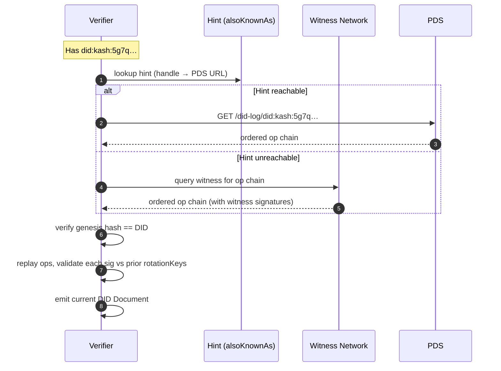

# Kash Identity Bible
**`specs/identity-protocol.md` — Phase 1, v0.2**

> **SUPERSEDED by [`identity-protocol-v1.md`](identity-protocol-v1.md) — retained for history.** This v0.2 draft predates the consolidated **Bible v1.1 (Phase-1 Final)**, which is the source of truth; where the two differ, v1.1 governs. Do not implement against this file. (Superseded 2026-07-05 per `CLEANUP.md` §C; audit-trail references keep it in the tree.)

> **Update note (2026-05-28):** M-of-N social-recovery primitives
> promoted from a use-case fixture into `@kashscript/identity-sdk/recovery`
> as a headless subpath. Multi-sig company identity flagship lands in
> `packages/identity-sdk/use-cases/paceplug-cofounder-multisig/`.
> Shipped as identity-sdk@0.1.3. Full delta in
> `specs/audit-2026-05-28-updates.md` (an internal change log, not in the public repository) §3.

> Source-of-truth specification for the Kash Identity Foundry. This document defines the protocol logic and the mathematical trust model only; no application code is normative here. All seven implementation phases (signer, SDK, resolver, witnesses, passkeys, zk, recovery UX) MUST conform.
>
> **v0.2 changelog** (driven by Red-Team Audit R1, see `identity-protocol-audit-r1.md`):
> P1 generalized recovery-tier guard (§3.2.1) · P2 Quorum Recovery (§3.5) · P3 generalized sibling resolution (§5.3) · P4 PDS forwarding + witness mandate (§5.1.1 + §5.6) · P5 action-bound intent (§4.3.1) · P6 resolver cache TTL ceilings (§6.3) · P7 Signer UX requirements (§4.5).

---

## 0. Goals & Non-Goals

### 0.1 Goals
- A **sovereign**, **headless**, **commercial-grade** decentralized identifier method (`did:kash`).
- **Logic-only:** the foundry hosts nothing; resolution happens against user-chosen Personal Data Stores (PDS) and an optional witness network.
- **Key rotation** without DID change. A leaked daily-signing key MUST NOT force the user to migrate identity.
- **Algorithmic agility:** Ed25519 today, with reserved slots for **Passkeys (WebAuthn / FIDO2)** and **zk-friendly curves** (BLS12-381, BN254).
- Inspiration drawn from **Nostr** (key-as-identity simplicity), **AT Protocol** (`did:plc` operation log + PDS), and **Web5** (DID + DWN separation).

### 0.2 Non-Goals
- Global namespace (handles are *advisory*, not authoritative — see §5.2).
- Consensus or token economics (anchored attestations live in `@kashscript/trade-core`, not here).
- Identity recovery via centralized custodian. Sovereignty is non-negotiable.

---

## 1. The `did:kash` Method

### 1.1 URI Structure

```
did:kash:<method-specific-identifier>
```

- `did` — fixed scheme, per W3C DID Core.
- `ks` — KashScript method identifier. Reserved; collision-free with `did:key`, `did:plc`, `did:web`, `did:ion`.
- `method-specific-identifier` — base32 (RFC 4648, lowercase, no padding) of the **Genesis Operation Hash** (see §1.3).

```
did:kash:5g7q2hvh3xkvjnq7tzaaymzfeswftxnnyya
```

> **Length.** The MSI is exactly **32 base32 characters** (160 bits / 20 bytes after decoding) — derived from the leftmost 20 bytes of `SHA-256(genesis-op-canonical-bytes)`. Truncation matches BTC's RIPEMD-160 footprint and yields a comfortable 2⁸⁰ collision margin for the foreseeable foundry user-base.

### 1.2 Why a Hash, Not a Public Key?

A pubkey-based DID (`did:key`-style) ties identity to a single signing key forever. Rotation is impossible without burning the identifier. A hash-based DID (PLC-style) lets the **DID** be permanent while the **key state** evolves through a signed operation chain. This is the whole reason commercial-grade systems can survive a stolen device.

### 1.3 The Genesis Operation

Every `did:kash` is born from a single **Genesis Operation** — a JSON object signed by the initial Management Key:

```jsonc
{
  "op":         "create",
  "version":    1,
  "createdAt":  "2026-05-09T12:00:00Z",
  "rotationKeys": [           // ordered priority list, see §3
    "z6Mki…M1",                // Master Key (cold)
    "z6Mki…R1"                 // Recovery Key (warm)
  ],
  "verificationKeys": [
    { "id": "#sig-1",  "alg": "ed25519",  "key": "z6Mki…A1" }
  ],
  "alsoKnownAs": ["at://kashif.kashscript.com"],
  "service": [
    { "id": "#pds",   "type": "PersonalDataStore", "endpoint": "https://pds.example.com" }
  ],
  "prev":      null,            // genesis has no predecessor
  "sig":       "z3jK…sig"       // multi-sig over canonical bytes (see §1.4)
}
```

**The DID is computed before publication:**

```
did:kash:<base32-truncate( SHA-256( canonicalize(genesis-op without "sig") ) , 20 bytes )>
```

The `sig` field is excluded from the hash because the signature itself depends on the canonical bytes. Once computed, the DID is immutable for the lifetime of the identity.

### 1.4 Canonicalization
- JSON Canonicalization Scheme (**JCS**, RFC 8785) is normative.
- All hashes use **SHA-256**.
- All multibase strings use the `z` prefix (base58-btc) per W3C Multibase.
- All multikey strings use the W3C Multikey codec table — Ed25519 = `0xed01`, secp256k1 = `0xe701`, BLS12-381-G2 = `0xeb01`.

### 1.5 Resolution (No Central Server)

Resolution is a deterministic replay of the operation log. Any party with the operation chain MAY reproduce the current DID Document.



**Authority hierarchy when sources disagree:**

1. The **operation chain** is canonical — bytes win.
2. **Witness network** acts as a tamper-evident log (think CT for DIDs). A fork attempt is detectable because witnesses sign the head.
3. **PDS** is convenience hosting — distrusted by default, verified by replay.

A resolver MUST reject any op whose `prev` does not point to the previous op's hash, or whose `sig` is not produced by a key listed in the previous op's `rotationKeys`.

---

## 2. The DID Document (Identity State)

### 2.1 Top-Level Shape (JSON-LD)

```jsonc
{
  "@context": [
    "https://www.w3.org/ns/did/v1",
    "https://kashscript.com/ns/did/v1"
  ],
  "id": "did:kash:5g7q2hvh3xkvjnq7tzaaymzfeswftxnnyya",
  "alsoKnownAs": ["at://kashif.kashscript.com"],

  "verificationMethod": [
    {
      "id":                  "did:kash:5g7q…#sig-1",
      "type":                "Multikey",
      "controller":          "did:kash:5g7q…",
      "publicKeyMultibase":  "z6MkiA…",
      "algorithm":           "ed25519",
      "purpose":             "active"
    },
    {
      "id":                  "did:kash:5g7q…#mgmt-1",
      "type":                "Multikey",
      "controller":          "did:kash:5g7q…",
      "publicKeyMultibase":  "z6MkiM…",
      "algorithm":           "ed25519",
      "purpose":             "management"
    }
  ],

  "authentication":   ["did:kash:5g7q…#sig-1"],
  "assertionMethod":  ["did:kash:5g7q…#sig-1"],
  "capabilityInvocation": ["did:kash:5g7q…#mgmt-1"],

  "service": [
    {
      "id":              "did:kash:5g7q…#pds",
      "type":            "PersonalDataStore",
      "serviceEndpoint": "https://pds.example.com"
    },
    {
      "id":              "did:kash:5g7q…#trade",
      "type":            "TradeAttestor",
      "serviceEndpoint": "https://attestor.duedale.app"
    },
    {
      "id":              "did:kash:5g7q…#neuron",
      "type":            "NeuronGateway",
      "serviceEndpoint": "https://gateway.oreoasis.app"
    }
  ],

  "createdAt": "2026-05-09T12:00:00Z",
  "updatedAt": "2026-05-09T12:00:00Z"
}
```

### 2.2 Verification Methods

Each entry has a `purpose` slot — a Kash extension to W3C Multikey:

| `purpose`     | Used for                                            | Location             |
|---------------|-----------------------------------------------------|----------------------|
| `active`      | Daily signing (handshake, signed messages, posts)   | Hot device           |
| `management`  | Authoring rotation/update operations                | Warm device          |
| `recovery`    | Emergency recovery if Management is lost            | Cold (paper / HSM)   |
| `assertion`   | Issuing verifiable credentials                      | Hot device           |
| `delegation`  | Capability delegation (object-capability tokens)    | Hot device           |

Standard W3C relationship arrays (`authentication`, `capabilityInvocation`, etc.) MUST reference verification methods whose `purpose` is consistent with the relationship — a resolver SHALL reject a document where, for example, a `purpose: active` key appears in `capabilityInvocation`.

### 2.3 Service Endpoints

Three first-class service types are reserved for the foundry's three protocols:

| `type`                | Owned by              | Holds                                         |
|-----------------------|-----------------------|-----------------------------------------------|
| `PersonalDataStore`   | `@kashscript/identity-core`| Records, posts, social graph, op log mirror   |
| `TradeAttestor`       | `@kashscript/trade-core`   | Reputation receipts, dispute history          |
| `NeuronGateway`       | `@kashscript/neuron`  | Consent-bound RAG and agent endpoints         |

Additional service types are permitted; resolvers SHOULD pass them through opaquely.

### 2.4 Required Invariants

- Every DID Document MUST contain at least one `purpose: active` and one `purpose: management` key.
- `id` MUST equal the Genesis Op hash; resolvers verify this on every load.
- `updatedAt` MUST equal the timestamp of the most recent op in the chain.

---

## 3. Key Management Lifecycle

### 3.1 Three-Tier Key Hierarchy

```
            ┌──────────────────────────────────┐
            │  RECOVERY KEY (cold, paper/HSM)  │   (off-line)
            └────────────┬─────────────────────┘
                         │ can replace
            ┌────────────▼─────────────────────┐
            │  MANAGEMENT KEY (warm device)    │   (rotation authority)
            └────────────┬─────────────────────┘
                         │ can rotate / replace
            ┌────────────▼─────────────────────┐
            │  ACTIVE KEY(S) (hot device)      │   (daily signing)
            └──────────────────────────────────┘
```

Privilege is **one-way**: a higher tier can rotate a lower tier; a lower tier cannot touch a higher tier. This is enforced at op-validation time.

### 3.2 Rotation Protocol

Rotation is performed via an `update` op signed by the current Management Key. The document below MUST reference the head of the existing chain:

```jsonc
{
  "op":         "update",
  "version":    1,
  "createdAt":  "2026-08-01T10:00:00Z",
  "prev":       "z3hashOfPriorOp",
  "patches": [
    { "op": "remove", "path": "/verificationKeys/sig-1" },
    { "op": "add",    "path": "/verificationKeys/-",     "value": { "id": "#sig-2", "alg": "ed25519", "key": "z6MkiB…" } },
    { "op": "replace","path": "/authentication",         "value": ["#sig-2"] }
  ],
  "sig":        "z…signedByCurrentManagementKey"
}
```

```mermaid
sequenceDiagram
    autonumber
    participant U as User (Signer)
    participant M as Management Key
    participant L as Op Log (PDS / Witness)
    participant V as Verifier (third-party app)
    Note over U: Active key compromised
    U->>U: generate new active keypair
    U->>M: build update op {prev, patches[remove old, add new]}
    M->>M: sign canonical bytes
    M->>L: publish op
    L->>L: append; broadcast to witnesses
    Note over V: Some time later
    V->>L: resolve did:kash:5g7q…
    L-->>V: chain incl. new op
    V->>V: replay; verify each sig against prior rotationKeys
    V->>V: emit fresh DID Document; old key no longer authenticates
```

**Validation rules a resolver MUST enforce on each op:**

1. `prev` matches the SHA-256 hash of the prior op's canonical bytes.
2. `sig` verifies under a key listed in the prior op's `rotationKeys` AND that key's `purpose` covers the requested change:
   - Removing/replacing a `purpose: management` key requires a Recovery Key signature.
   - Removing/replacing a `purpose: recovery` key requires a Recovery Key signature **OR** a quorum signature from §3.5.
   - All other patches accept a Management Key signature.
3. The op's `createdAt` is monotonically non-decreasing relative to `prev`.
4. The patch set leaves the document in a state satisfying §2.4 invariants.

### 3.2.1 Recovery-Tier Guard (Patch P1)

Any op — regardless of signing tier — whose patch set adds, removes, or replaces an entry of `purpose: "recovery"` is **non-final for `RECOVERY_WINDOW = 72 h`**. Within the window:

- A Recovery Key MAY publish a competing op that supersedes it.
- A quorum (§3.5) MAY publish a competing op that supersedes both.

Resolvers MUST NOT treat such ops as canonical until the window closes. Among competing ops within the window, tier precedence applies (see §5.3): Quorum > Recovery > Management. Among same-tier siblings, lowest tip-hash wins.

This closes the *stolen-phone race* — even if a thief acquires both Active and Management keys in a single device compromise, they cannot finalize the removal of a Recovery Key fast enough to outrun the legitimate user holding the cold Recovery Key.

### 3.3 Recovery (Emergency Path)

If the Management Key is lost or compromised, the **Recovery Key** publishes a `recover` op that replaces the Management Key wholesale. Recovery ops carry an extra **fork-window guard** — a constant `RECOVERY_WINDOW = 72h` — within which a competing recovery op signed by a *different* Recovery Key (e.g., from an attacker who stole one Recovery slot) MAY be observed. Resolvers MUST wait `RECOVERY_WINDOW` before treating a recovery as final, and prefer the op with the lowest hash on tie. This mirrors PLC's late-publish defense.

### 3.4 Revocation & Deactivation

- **Soft revoke** of a single key: an `update` op removes the verification method.
- **Hard deactivation** of the entire identity: a `deactivate` op signed by Management. After deactivation, no further ops are accepted; the DID Document is permanently `tombstoned: true` and `authentication` is empty. Replays still succeed (history is immutable) but no signature can authenticate as the DID.

### 3.5 Quorum Recovery — Social-Recovery Tier (Patch P2)

To survive *total loss* (every key in §3.1 destroyed), users MAY pre-publish a `set-recovery-quorum` op designating **N guardian DIDs** and a threshold **M ≤ N**. Once published, M guardians can co-sign a `quorum-recover` op replacing the Active, Management, and Recovery key sets wholesale.

```jsonc
// set-recovery-quorum (signed by current Recovery Key)
{
  "op":         "set-recovery-quorum",
  "version":    1,
  "createdAt":  "2026-05-09T12:00:00Z",
  "prev":       "z3hash…",
  "threshold":  3,                          // M
  "guardians": [                            // N
    "did:kash:abc…",
    "did:kash:def…",
    "did:kash:ghi…",
    "did:kash:jkl…",
    "did:kash:mno…"
  ],
  "sig":        "z…recoveryKeySig"
}

// quorum-recover (M attestations bundled together)
{
  "op":         "quorum-recover",
  "version":    1,
  "createdAt":  "2026-09-12T08:00:00Z",
  "prev":       "z3hashOfPriorOp",
  "newRotationKeys":     [ "z6Mki…M2", "z6Mki…R2" ],
  "newVerificationKeys": [ { "id": "#sig-2", "alg": "ed25519", "key": "z6Mki…A2" } ],
  "attestations": [
    { "guardian": "did:kash:abc…", "sig": "z…sig1" },
    { "guardian": "did:kash:def…", "sig": "z…sig2" },
    { "guardian": "did:kash:ghi…", "sig": "z…sig3" }
  ]
}
```

**Validation requirements:**

1. Each `attestation.sig` MUST verify under the *current* `purpose: active` key of the guardian DID, resolved fresh through the same `did:kash` machinery.
2. The set of attesting guardians MUST be a subset of the most recent `set-recovery-quorum` op's `guardians`.
3. The number of valid attestations MUST be ≥ `threshold`.
4. Quorum-recover ops are subject to §3.2.1 `RECOVERY_WINDOW`.

**Privilege ladder including quorum:**

```
Quorum  ─►  Recovery  ─►  Management  ─►  Active
```

The protocol is recursively composable — guardian DIDs are themselves `did:kash` identities resolved by the same rules. **No KashScript hosting is required**; the foundry holds no quorum state. Sovereignty is preserved because the user picks their own guardians.

> ⚠ **Product guidance (non-normative):** users SHOULD pick guardians that are geographically and socially diverse, and prefer thresholds M ≥ 3. Guardian collusion is the residual risk, addressed in `identity-protocol-audit-r1.md` §IV.

---

## 4. The Handshake Protocol — Logic SDK Flow

The handshake is a four-step **challenge-response** between a third-party application and the user's Kash Signer (browser extension, mobile app, or hardware device). It produces a short-lived authenticated session tied to a specific intent.

### 4.1 The Four Steps

1. **Announce.** Client (browser/app) sends `did` and `intent` to the third-party app.
2. **Challenge.** App responds with `nonce` (≥128 bits, CSPRNG), `intent` echo, `audience`, `expiresAt`.
3. **Sign.** Kash Signer presents the intent to the user, awaits consent, signs `canonicalize({nonce, intent, audience, expiresAt, did})` with the Active Key.
4. **Verify.** App resolves the DID, locates the active key referenced in `authentication`, and verifies the signature. On success, an authenticated session is established.

### 4.2 Diagram

```mermaid
sequenceDiagram
    autonumber
    participant C as Client (app frontend)
    participant K as Kash Signer
    participant A as 3rd-Party App (server)
    participant R as DID Resolver
    C->>A: 1. announce { did, intent }
    A-->>C: 2. challenge { nonce, intent, audience, expiresAt }
    C->>K: forward challenge for user consent
    K->>K: present intent; await user approval
    K->>C: 3. signed { challenge, sig, kid }
    C->>A: forward signed envelope
    A->>R: resolve(did)
    R-->>A: DID Document
    A->>A: 4. verify(sig) under document.authentication[kid]
    alt sig OK & not expired & audience matches
        A-->>C: session token
    else any check fails
        A-->>C: 401
    end
```

### 4.3 Replay & Confused-Deputy Defenses

- **`audience`** binds the proof to a specific origin / RP ID. A signature for `app.duedale.app` MUST NOT validate at `evil.example.com`.
- **`nonce`** is single-use; the verifier persists used nonces for at least `expiresAt + clock_skew`.
- **`intent`** is human-readable in the Signer UI but its *structured* form is verifier-checked (see §4.3.1).
- **`kid`** identifies which `verificationMethod` produced the signature so verifiers do not have to brute-force across keys.

### 4.3.1 Action-Bound Intent (Patch P5)

Free-form intent strings are deprecated as of v0.2. The `intent` field MUST follow the schema:

```
<protocol-namespace>.<action>:<param-digest>
```

Examples:

| Use case                     | Canonical `intent`                                                   |
|------------------------------|----------------------------------------------------------------------|
| Sign in to Duedale           | `auth.signin:realm=duedale.app`                                      |
| Create a listing             | `trade.create-listing:sha256(<canonical-listing-bytes>)`             |
| Authorize Neuron RAG access  | `neuron.grant-context:sha256(<scope-descriptor>)`                    |
| Update profile name          | `identity.profile-update:sha256(<patch-bytes>)`                      |

**Verifier MUST:**

1. Re-compute the `param-digest` from the actual request payload at the moment of verification.
2. Compare it byte-for-byte against the digest embedded in the signed `intent`.
3. Hard-fail (HTTP 401, no retry) on any mismatch — `audience`, `nonce`, `expiresAt`, or digest.

This closes the *intent-substitution* gap: a captured signature cannot be repurposed to authorize a different listing, a different transfer, or a different scope, even within the same app.

### 4.4 Signature Format

```
sig = Ed25519.sign( sk_active , JCS(canonical-payload) )
```

Where `canonical-payload` includes a domain-separation tag:

```
"kash-handshake-v1\n" || canonical-payload-bytes
```

The DST prevents a signature for one Kash subprotocol (e.g., trade attestation) from being replayed as a handshake.

### 4.5 Signer UX Conformance (Patch P7)

The handshake's security ultimately rests on the human consent boundary. Conformant Signers MUST:

1. Render `intent` (in its human-readable form) as the **largest typographic element** on the consent screen.
2. Render `audience` **unabbreviated** and visually distinct from chrome (no truncation of `app.duedale.app` to `…duedale.app`).
3. **Re-prompt** the user if either `intent` or `audience` changes between announce and sign.
4. Block consent for at least **800 ms** after first render to defeat clickjacking.
5. Display the signing key's `kid` and its `purpose` so users can confirm an action is being signed by an Active Key (not, say, a Management Key).

Non-conformant signers SHALL be marked `untrusted` in the foundry's signer registry. Apps MAY refuse to handshake with untrusted signers.

---

## 5. Edge-Case Resolution

### 5.1 Migrating PDS Provider

The user moves from `pds.example.com` to `pds.self-hosted.io`:

1. New host imports the user's record set (existing record-CIDs are content-addressed — bytes verify regardless of host).
2. User publishes an `update` op patching `service[id=#pds].serviceEndpoint`.
3. New op enters the chain. Resolvers pick up the new endpoint within one resolution.
4. Old PDS continues to serve the op log read-only as a courtesy mirror; eventually it goes dark.

The DID never changes, the social graph never breaks, third-party apps re-resolve naturally on next handshake.

#### 5.1.1 Forwarding Mandate (Patch P4)

A migrating PDS MUST honor `GET /did-log/<did>` and `GET /xrpc/com.atproto.sync.getRepo?did=<did>` with HTTP `410 Gone` and a `Kash-Forward-To: <new-endpoint>` header for **at least 90 days post-migration**. Resolvers honoring the forward MUST re-verify the new host against the witness quorum (§5.6) before trusting it. This makes a single migration non-fatal even if the user never logs back into stale apps within the forwarding window.

### 5.2 Identity Squatting & Handle Collisions

`did:kash` is the authority. Handles (`alsoKnownAs`) are *advisory* and resolved separately:

- Handles use the AT-Protocol-style format `at://<handle>` and resolve via DNS TXT or `.well-known/kashscript-did.json`.
- A handle pointing to a DID that does not list the same handle in `alsoKnownAs` is **bidirectional-failed** and MUST be rendered as untrusted.
- The first claim wins **at the handle level**, but losers retain their DID. Squatting is a UX nuisance, not an identity attack.
- For high-stakes namespaces (e.g., `kashif.kashscript.com`), the foundry's reserved `kashscript.com` zone delegates to a small allowlist; everyone else self-hosts handles on domains they already control.

### 5.3 Sibling Resolution — General Fork Rule (Patch P3)

Two ops sharing a `prev` are **siblings**. Resolution applies to *any* sibling pair, not only recovery-vs-recovery races:

1. **Tier precedence.** If signing tiers differ, the higher tier wins:
   ```
   Quorum  >  Recovery  >  Management
   ```
2. **Hash tiebreak.** If tiers match, the op with the lower SHA-256 tip-hash wins.
3. **Window.** When at least one sibling carries a recovery-tier guard (per §3.2.1), resolution waits until `RECOVERY_WINDOW` closes. Otherwise resolution is immediate on receipt of the second sibling.
4. **Finality.** Once a sibling is decided, the losing branch and **all its descendants** are permanently invalid. Anything signed under the loser becomes unverifiable.

**Offline-conflict guidance for Signers.** A Signer that holds a buffered op while the user is offline SHOULD, on reconnect, query the witness quorum for the chain head and compare it to the buffered op's `prev`. If `prev` is no longer the head, the Signer MUST surface the conflict to the user (with a diff of the intervening ops) before publishing — otherwise the user's offline edit silently loses to whoever published first.

### 5.4 Clock Skew

Verifiers MUST tolerate ±5 minutes of clock drift on `expiresAt` and op `createdAt`. Larger drift is rejected — too lenient permits long-lived replays.

### 5.5 Op-Chain Replay Determinism

Resolution is deterministic given the same set of ops. Two honest resolvers operating over the same chain MUST produce byte-identical DID Documents. Any divergence is an implementation bug.

### 5.6 Witness Network — Mandatory Co-Signing (Patch P4)

Every genesis op MUST include a `witnesses` field listing **at least three independent witness DIDs**:

```jsonc
{
  "op": "create",
  ...
  "witnesses": [
    "did:kash:wit-aaa…",
    "did:kash:wit-bbb…",
    "did:kash:wit-ccc…"
  ],
  ...
}
```

**Witness duties:**
- Co-sign every op published to the chain after verifying the parent linkage and signing-tier rules.
- Maintain an append-only public log of co-signed heads (think Certificate Transparency).
- Refuse to co-sign forks (a witness that signs both siblings of a fork is provably dishonest and SHOULD be removed).

**Resolver duties:**
- Verify each newly-fetched op chain co-signed by a **strict majority** of the declared witnesses (`⌈N/2⌉ + 1`).
- Reject chains that pass cryptographic signature checks but lack witness quorum.
- Cache witness co-signatures for offline verification.

**Witness rotation.** A Management-tier op MAY add or remove witnesses subject to standard fork rules. Removing witnesses is risky (a temporarily-down witness might be replaced by a malicious one); product UX SHOULD warn users.

> ⚠ **Product guidance (non-normative):** users SHOULD pick witnesses run by *operationally independent* operators — three witnesses on the same cloud provider effectively count as one.

---

## 6. Forward Compatibility

### 6.1 Passkeys (Phase 4)

The `verificationMethod` schema reserves a `type: "WebAuthnPasskey"` slot:

```jsonc
{
  "id":          "did:kash:5g7q…#passkey-1",
  "type":        "WebAuthnPasskey",
  "controller":  "did:kash:5g7q…",
  "algorithm":   "es256",        // P-256 ECDSA, the WebAuthn baseline
  "credentialId":"…opaque…",
  "rpId":        "kashscript.com",
  "attestation": "…opaque…",
  "purpose":     "active"
}
```

The handshake's signed payload is wrapped in a WebAuthn `clientDataJSON` and the signature includes `authenticatorData`. Verifiers compute the WebAuthn-prescribed digest before validating against the credential public key. **No protocol change is required** — Passkeys are a verification-method type, not a different handshake.

### 6.2 zk-Proofs (Phase 5)

Two extension points:

1. **zk-friendly verification methods.** Reserved algorithms: `bls12-381-g2`, `bn254-poseidon`. A `purpose: "assertion"` key over BLS12-381 lets a holder produce a Groth16 / PLONK witness asserting attributes ("over 18", "Pakistan resident") without revealing the underlying credential.

2. **Selective-disclosure verifiable credentials.** Credentials issued by a `did:kash` with a BBS+ key (BLS12-381) admit zk-derived presentations. The DID Document is the resolution anchor — no extra protocol layer is needed.

Both extensions slot into the same op-log model; rotation works identically. The only constraint on Phase 1 implementations: **do not bake Ed25519 assumptions into resolver code paths that touch `algorithm`** — keep curve dispatch table-driven.

---

## 6.3 Resolver Cache TTL Ceilings (Patch P6)

Resolvers MAY cache DID Documents to bound resolution latency, subject to a hard TTL ceiling per use-case:

| Operation class                                   | Maximum TTL |
|---------------------------------------------------|-------------|
| Security-sensitive (login, key change, transfer)  | **60 s**    |
| Capability invocation (delegated auth)            | **5 min**   |
| Cosmetic reads (display name, avatar URI)         | **24 h**    |

Resolvers SHOULD subscribe to witness webhooks for proactive cache invalidation; failure to do so does not relax the TTL ceilings. A revoked Active Key MUST stop authenticating within 60 s of the rotation op clearing the witness quorum — this is the load-bearing security property the cache TTL exists to preserve.

## 7. Versioning

| Field             | Behaviour                                                                |
|-------------------|--------------------------------------------------------------------------|
| `version` (op)    | Integer. Bumped only on breaking changes to op semantics.                |
| `@context` (doc)  | Append-only. New keys land in `https://kashscript.com/ns/did/v1`.        |
| Resolver          | MUST refuse `version` it does not understand (no silent best-effort).    |
| Witness API       | Versioned via URL path (`/v1/`); major bumps run side-by-side for 90 d.  |

---

## Appendix A — Cryptographic Primitives

| Primitive            | Choice                              | Justification                                           |
|----------------------|-------------------------------------|---------------------------------------------------------|
| Hash                 | SHA-256                             | Universal, hardware-accelerated, widely audited.        |
| Canonical JSON       | RFC 8785 (JCS)                      | Deterministic, no library divergence.                   |
| Active signature     | Ed25519 (RFC 8032)                  | Fast, deterministic, no nonce-reuse risk.               |
| Passkey signature    | ES256 (P-256, WebAuthn baseline)    | Mandated by FIDO2; hardware-backed on most devices.     |
| zk-friendly          | BLS12-381 (G2 keys, G1 sigs)        | Pairing-friendly; ecosystem alignment with Aleo, Mina.  |
| Multibase            | RFC-draft `z` (base58-btc)          | W3C Multikey alignment; URL-safe-ish.                   |
| Multikey codec       | W3C registry                        | Curve-agile without protocol churn.                     |

## Appendix B — Reserved IDs

| ID fragment   | Purpose                                          |
|---------------|--------------------------------------------------|
| `#sig-N`      | Active signing keys, `N` ≥ 1                     |
| `#mgmt-N`     | Management keys                                  |
| `#rec-N`      | Recovery keys                                    |
| `#quorum`     | Quorum-recovery configuration (§3.5)             |
| `#witness-N`  | Witness DID declarations (§5.6)                  |
| `#pds`        | Personal Data Store                              |
| `#trade`      | Trade attestor endpoint                          |
| `#neuron`     | Neuron gateway endpoint                          |
| `#passkey-N`  | WebAuthn-bound active key (Phase 4)              |
| `#zk-N`       | zk-proof issuance/verification key (Phase 5)     |

## Appendix C — Test-Vector Plan (Phase 2 deliverable)

Phase 2 will publish a frozen test-vector suite covering: genesis hashing, op-chain replay, valid + invalid rotations, recovery within and beyond the window, fork resolution, and handshake verification. Vectors live at `specs/vectors/identity-v1/` and are versioned with the protocol.

---

**End of Phase-1 specification.** All implementation phases (Signer, SDK, Resolver, Witness Network, Passkey adapter, zk adapter, Recovery UX) MUST cite section numbers from this document; deviations require an amendment commit to this file before code lands.

---

## Amendment — 2026-07-04 — terminology unification (ROADMAP P0)

The DID method label is unified to `did:kash` throughout, matching the shipped
`@kashscript/identity-core` runtime (which enforces `did:kash` and rejects the retired
spelling). Prose/label change only; no protocol-semantic change. See the companion Bible
`identity-protocol-v1.md` for the shipped-vs-target implementation-status note.
